  

  
  
  

### ✦ About me

- 🎓 Final-year **Data Science & AI engineering** student at **INPT Rabat**
- 🧠 I build **LLM agents, RAG pipelines, data platforms** and **deep learning** models, end to end
- 💼 Interned at **DXC Technology** (AI copilot for IT operations) and **AI-Crafters** (AI learning agent)
- 🔭 Looking for a **final-year internship (PFE)** in Data & AI

### ✦ Highlights

| Project | What it is | |
|---|---|---|
| 🎬 **CineMatch** | Hidden-gem movie recommendations and trend prediction on a Spark / Kafka / Delta Lake lakehouse | [Live ↗](https://cinematch.azurewebsites.net) |
| 💊 **DwaTalk** | Medicine & pharmacy assistant in Darija, Arabic and French, with OCR on medicine boxes | [Live ↗](https://pharmacy-assistant-darija.vercel.app) |
| 🤖 **OpsCopilot AI** | LLM agent + RAG + MCP tools that diagnose and fix IT incidents, with human approval | [Code ↗](https://github.com/kawthar-khayet/Opscopilot_AI) |
| 🎙️ **Speech Emotion Recognition** | Fine-tuned Wav2Vec2: 54% → 84.9% accuracy on 7 emotions | [Code ↗](https://github.com/kawthar-khayet/Speech-Emotion-Recognition-using-Deep-Learning) |

More internships and projects in my <a href="https://kawthar-khayet.github.io">personal space ✦</a>

### ✦ Tools I use

  

